# Mobile audit report: November 2, 2026

Branch `feat/mobile-first`, from `main` at `5809f4d`. Design rationale and the manual device procedure are in [docs/design/MOBILE.md](../design/MOBILE.md).

**Evidence types used below:**

- **Automated browser emulation:** Playwright Chromium with viewport, device scale, touch and mobile flags.
- **Lab performance:** Lighthouse, or Chromium with throttling.
- **Physical devices:** none were available. No physical-device result is claimed anywhere in this report.

## Results at a glance

| Check                                                   | Before (main `5809f4d`) | After                                     |
| ------------------------------------------------------- | ----------------------- | ----------------------------------------- |
| Viewport-matrix layout audit, 15 pages × 14 sizes (210) | 181 passed, 29 failed   | **210 passed**                            |
| Phone interaction tests (Pixel 7 profile)               | none                    | **7 passed**                              |
| Unit tests                                              | 131                     | **138 passed**                            |
| Lighthouse accessibility, 6 pages                       | not measured            | **100 on all six**                        |
| Hydration errors on server-rendered pages               | n/a                     | **0** (one real mismatch found and fixed) |

Lint shows 0 errors and 4 warnings. All four are React Compiler notices that React Hook Form's `watch()` components are not auto-memoized. Typecheck, Prettier and the production build pass.

## What the automated audit checks

`apps/web/e2e/mobile.spec.ts` runs every page at 320×568, 360×800, 375×667, 390×844, 393×852, 414×896, 430×932, 568×320 and 932×430 (landscape phones), 768×1024, 1024×768, 1280×800, 1440×900 and 1920×1080. At each size it checks:

1. Page-level horizontal overflow, naming the culprit element.
2. Text clipped without an ellipsis.
3. Controls under 44×44 CSS px (inline text links excepted, per WCAG 2.5.8).
4. Fixed bars covering the last control, after scrolling the page and every inner scroll area to the end.
5. Console errors and page errors (hydration mismatches surface as page errors).

It also saves a full-page screenshot. Public pages run in CI; signed-in pages run when `KM_E2E_EMAIL`/`KM_E2E_PASSWORD` name a dedicated test account. The test account holds 18 clearly labelled synthetic runs on real Calgary OpenStreetMap loops.

## Issues found and fixed

| Issue                                                      | Where / sizes                                                                                | Fix                                                                                                                                                                 | Regression test                                          |
| ---------------------------------------------------------- | -------------------------------------------------------------------------------------------- | ------------------------------------------------------------------------------------------------------------------------------------------------------------------- | -------------------------------------------------------- |
| Page 29 px wider than the screen                           | Runs at 320, tablet                                                                          | Visually-hidden table labels escaped their scroll container; scroll containers are now positioned and `.sr-only` uses `clip-path`                                   | layout audit                                             |
| Landing header overflow                                    | 320                                                                                          | Header CTA hides at ≤ 380 px (the hero carries it)                                                                                                                  | layout audit                                             |
| 38–40 px touch targets                                     | Rail links (tablet, landscape phones), split tabs, `summary`, compare checkbox, Ghost slider | 44 px minimums; the label is the checkbox hit target; range rows are 44 px                                                                                          | layout audit                                             |
| Split table clipped HR and squeezed the bars               | Run analysis at 320                                                                          | Tighter phone cells and fewer columns; bar and percentage fit                                                                                                       | `mobile-flows`: "run analysis fits a phone"              |
| Next workout below the fold                                | Home, all phones                                                                             | Phone order: next → week → last run → status → history                                                                                                              | `mobile-flows`: "Home leads with the next workout"       |
| Planner opened as a long form under the map                | All phones                                                                                   | Full-screen map, three-stop bottom sheet, distance chips, collapsed preferences                                                                                     | `mobile-flows`: sheet drag/keys/tap; `use-sheet.test.ts` |
| Route panel covered undo/redo                              | Landscape phones                                                                             | Side dock, tools stacked beside it                                                                                                                                  | layout audit                                             |
| "Tap the map" but the map was below the form               | Conditions, phones                                                                           | Map first, Use My Location, one-tap chips                                                                                                                           | `mobile-flows`: condition chips                          |
| Week calendar was seven 140 px columns, scrolling sideways | Training, phones                                                                             | Vertical agenda with "Rest" days                                                                                                                                    | `mobile-flows`: agenda                                   |
| Ghost scrubber about 40 px wide                            | Ghost, phones                                                                                | Full-width scrubber row                                                                                                                                             | layout audit                                             |
| Browser/Android Back left the page while More was open     | All phones                                                                                   | The sheet owns a history entry                                                                                                                                      | `mobile-flows`: Back closes More                         |
| Tab bar sat on the keyboard and covered fields             | All phones                                                                                   | Hidden while a field is focused; `interactive-widget=resizes-content`                                                                                               | `mobile-flows`: keyboard                                 |
| Embedded maps trapped one-finger page scrolling            | Run, Ghost, Conditions                                                                       | MapLibre cooperative gestures (two fingers move the map)                                                                                                            | none; manual check listed                                |
| Weekly goal typed in metres ("40000")                      | Settings, onboarding                                                                         | Entered in km or mi, stored as metres                                                                                                                               | `forms.test.tsx`                                         |
| Edit/delete off-screen inside the table scroll             | Runs list, phones                                                                            | Phone rows keep essentials; delete (confirmed) added to every record's page                                                                                         | layout audit                                             |
| "Splits" jump link did nothing while loading               | Run analysis                                                                                 | Section renders a placeholder while loading; chips only for sections that exist                                                                                     | `mobile-flows`                                           |
| **Hydration mismatch discarded server HTML**               | Home, around midnight                                                                        | Server and browser disagreed on "today" (different tz databases for Alberta's 2026 change). Hydration now reuses the server's date, then switches to the browser's. | `dates.test.ts`; audit fails on page errors              |

## Before / after (390 × 844 unless noted)

| Screen                             | Before                                               | After                                               |
| ---------------------------------- | ---------------------------------------------------- | --------------------------------------------------- |
| Home                               | 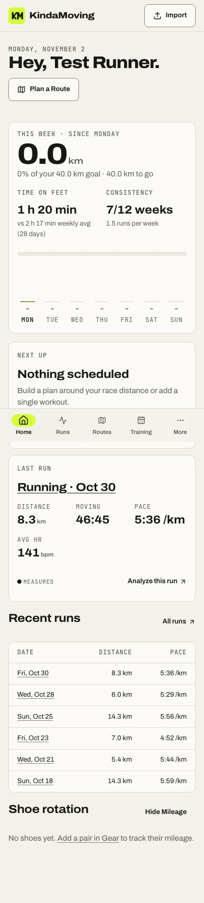            | 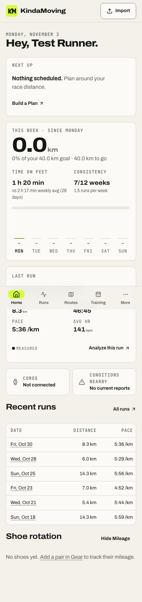            |
| Route planner                      | 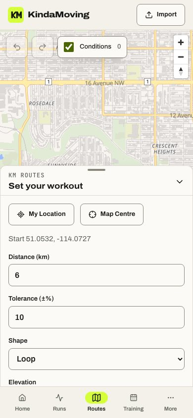         | 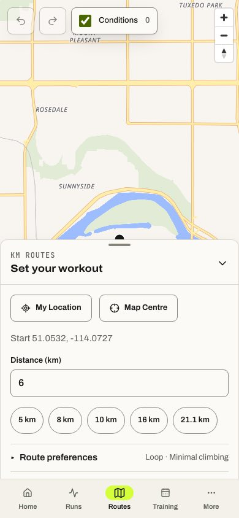         |
| Route planner, 320 × 568           | 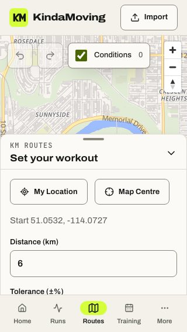           | 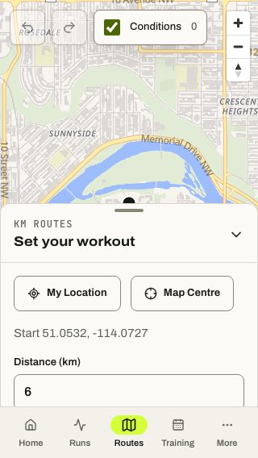           |
| Route planner, landscape 568 × 320 | 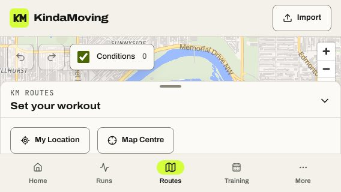 | 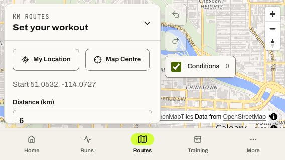 |
| Run analysis                       | 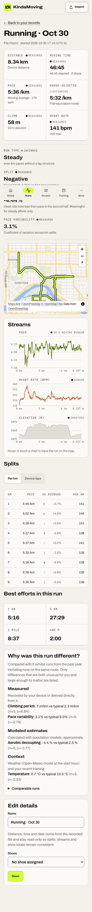             | 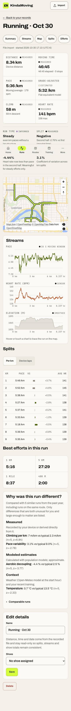             |
| Run analysis, 320 × 568            | 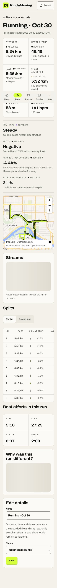               | 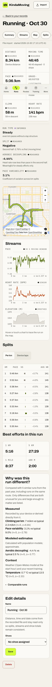               |
| Conditions                         | 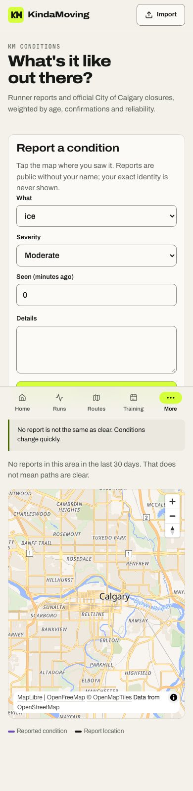      | 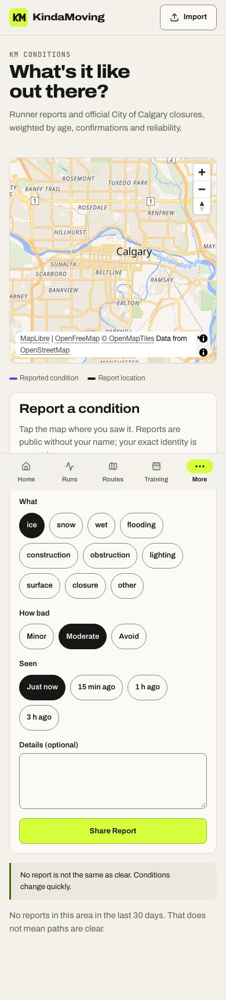      |
| Training                           | 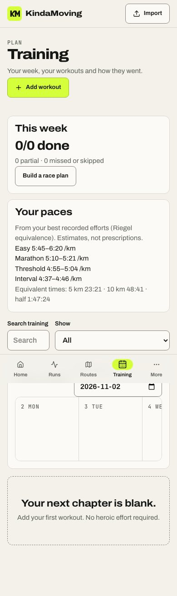        | 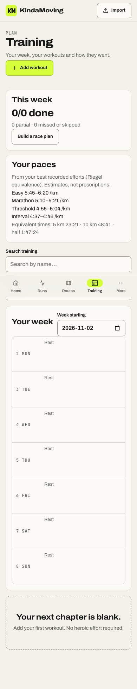        |
| Runs                               | 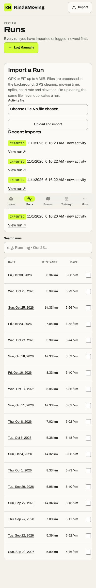            | 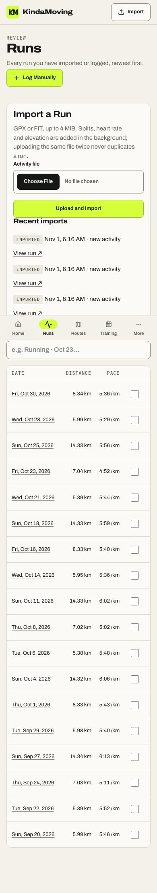            |
| Ghost                              | 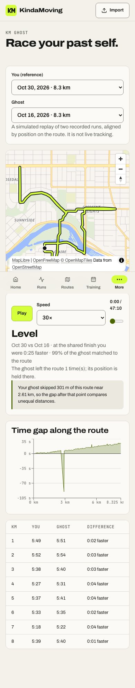           | 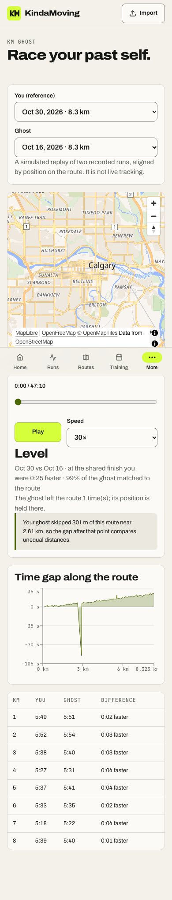           |
| Home, 320 × 568                    | 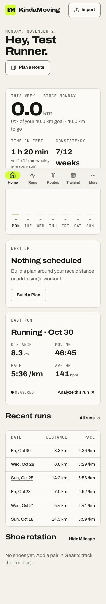              | 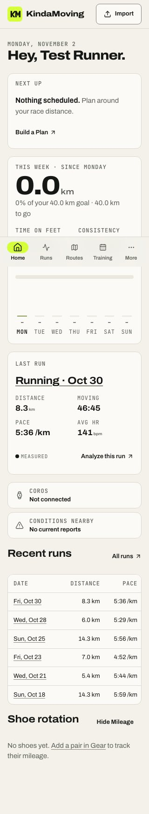              |
| Landing, 320 × 568                 | 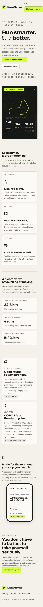           | 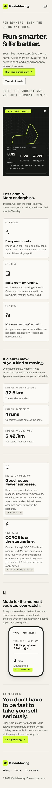           |

Full-page captures include the fixed tab bar mid-page; that is an artifact of stitched screenshots. The full 210-image set is reproducible with the audit spec.

## Accessibility

- **Lighthouse accessibility** scored 100 on landing, login, Home, planner, run analysis and Trends (mobile profile).
- **Contrast:** all text meets at least 4.5:1, and control borders at least 3:1, in both themes (measured; see TOKENS.md).
- **Touch and keyboard:** every control is at least 44×44 at every tested size. The sheet works by keyboard (ArrowUp/Down, Enter). Gestures have alternatives: Map Centre and My Location instead of map taps, undo/redo buttons, chips instead of typing.
- **Screen readers:** landmarks and section headings are in place. The planner has a visually hidden H1 and a labelled map region. Chart values repeat as text (cursor readout and split table). Provenance and status never rely on colour alone.
- **Outdoor use:** the high-contrast ink/paper theme, 16 px+ inputs, large chip targets, and minimal typing for reporting conditions.

## Performance (lab data, not field data)

Production build, served locally. Lighthouse 12.8.2 mobile profile with **applied** DevTools throttling (slow 4G, 4× CPU), median of two runs. No field (real-user) data exists yet, because nothing is publicly deployed.

| Page                          | Perf               | LCP                         | TBT    | CLS   | Notes                                          |
| ----------------------------- | ------------------ | --------------------------- | ------ | ----- | ---------------------------------------------- |
| Landing                       | 99                 | 1.53 s                      | 6 ms   | 0.061 | cold                                           |
| Login                         | 100                | 1.53 s                      | 14 ms  | 0     | cold                                           |
| Route planner (signed in)     | 94                 | 1.56 s                      | 109 ms | 0.029 | cold; MapLibre loads after first paint         |
| Run analysis (signed in)      | 88                 | 1.55 s                      | 470 ms | 0.041 | cold; server-rendered from prefetched data     |
| Trends (signed in)            | 97                 | 1.53 s                      | 132 ms | 0     | cold                                           |
| Home (signed in)              | 84                 | 4.37 s                      | 10 ms  | 0.047 | cold, **before** the hydration fix (see below) |
| Home / run / planner / Trends | 100 / 92 / 98 / 99 | 0.99 / 0.98 / 0.69 / 0.66 s | —      | —     | repeat visit (warm cache), after prefetch      |

The Home and run pages are now prefetched on the server, and the browser no longer waits on its own API round trips.

The cold Home figure above was captured while the hydration bug was still present: React discarded the server HTML and redrew it once JS arrived. After the fix:

- A throttled trace showed the server-rendered hero as the LCP element at first paint.
- The dev server reports no hydration error, checked at a moment when server and browser disagreed on the date.

Re-running cold Lighthouse on Home afterwards was not possible: the local Lighthouse runs became unreliable (navigation time-outs, and lost signed-in state), so **no post-fix cold Home score is claimed**.

Earlier signed-in "before" figures (Home 5.3 s, run 5.0 s) came from an injected-cookie method that broke the browser session. They are excluded as invalid.

**Remaining performance risk:** 470 ms TBT on run analysis at 4× CPU (Recharts plus MapLibre parse). This is a likely input-delay hotspot on low-end Android; the candidate fix is deferring the map until scrolled into view.

## Physical device verification

**Not performed:** no physical iPhone or Android device was available in this session. Real Safari keyboard behaviour, Dynamic Island and home-indicator insets, real GPS permission prompts, PWA install, file pickers and Android Back are therefore **unverified on hardware**. The emulated tests cover the logic, not the hardware. The required manual procedure is in [MOBILE.md § Physical-device acceptance](../design/MOBILE.md#physical-device-acceptance-manual).

## Known remaining items

1. Physical-device acceptance, as above.
2. The first visit to Home (before the zone/locale cookie exists) renders a skeleton until hydration; later visits are server-rendered.
3. iOS Safari ignores `interactive-widget`. It pans the focused field into view instead, and hiding the tab bar uses `:has()` (Safari 15.4+).
4. Bottom-sheet drags were tested with emulated pointer input, not real touch latency or momentum.
5. Tracks and Community do not exist in the product, so there was nothing to audit for them.
6. Production deployment blockers from Phase 4 are unchanged: the Render secrets, the read-only DB login and the Calgary import DSN all need the operator.
