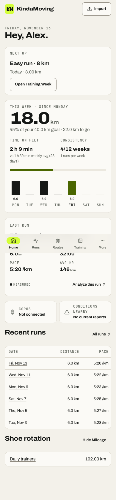
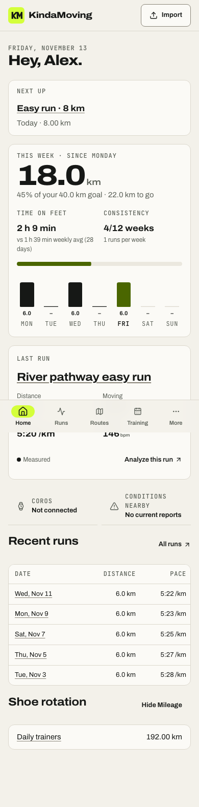
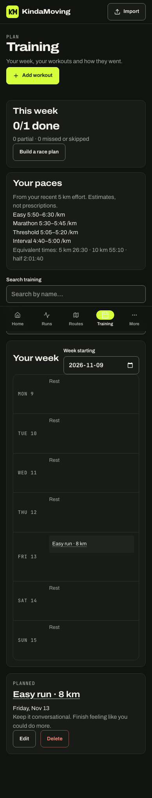
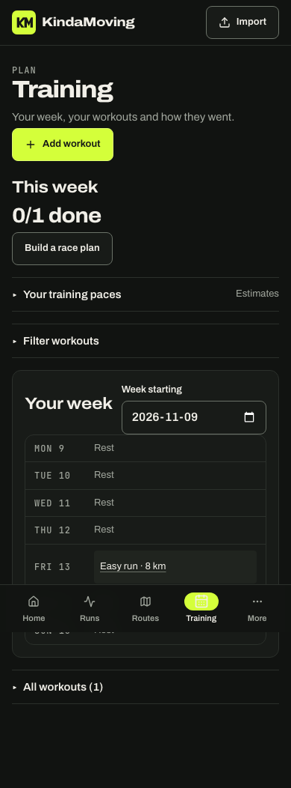

# UI refinement audit

Baseline: `77d33c3` (remote and local main verified 2026-11-13). Work is isolated from the user's existing analytics-test edit. This is a refinement of the current design, not another redesign.

## Evidence and method

The existing design documents, global CSS, `@km/ui`, all page entry points and their shared controls were inspected. Chromium rendered 19 screens in light/dark at 390×844 and 1440×900 before implementation. A loopback read-only synthetic upstream supplies a fictional runner; browser API responses are intercepted and mutations rejected. Empty map tiles are a deterministic layout fixture, not a real basemap. No hosted account, watch, storage or database is used.

Original screenshots: `output/playwright/ui-refinement/before/`. Final screenshots and per-screen layout/console findings: `output/playwright/ui-refinement/after/`. Screenshots are real browser captures; fixture data is synthetic. Representative comparisons are retained alongside this report after verification.

## Prioritized findings before implementation

| Severity | Location                                        | Evidence / user impact                                                                                                                                                   | Decision                                                                                                                                                        |
| -------- | ----------------------------------------------- | ------------------------------------------------------------------------------------------------------------------------------------------------------------------------ | --------------------------------------------------------------------------------------------------------------------------------------------------------------- |
| High     | Training agenda, `globals.css` `.day .eyebrow`  | A nine-row span stretches rest days into large empty blocks. The week requires excessive scrolling.                                                                      | Remove artificial row spanning; keep date and workouts/rest aligned.                                                                                            |
| High     | Gear, `resource-page.tsx` + `gear-overview.tsx` | Each shoe appears twice, once as an editable inventory item and again with wear information. Dark-mode wear uses charcoal on charcoal.                                   | One shoe entry with mileage and wear; contextual management; theme-aware progress.                                                                              |
| High     | Routes planner                                  | Find Routes sits below the initial half sheet's scroll area. Generic Add route is brighter than Plan a route on the library.                                             | Keep generation reachable in a sticky panel action; make planning the primary library action.                                                                   |
| High     | Home status                                     | Failed COROS status queries look like “Not connected”; reconnect and provider errors are flattened into the same status.                                                 | Distinguish unavailable, error and reconnect states without adding badges.                                                                                      |
| Medium   | Home                                            | Next workout repeats its link as a separate large button. Latest run repeats in recent history. Import repeats beside the global Import action.                          | Compact next workout; history starts after the latest run; one global Import entry.                                                                             |
| Medium   | Runs                                            | The import form consumes most of the initial phone viewport. Log Manually and Upload compete in Volt.                                                                    | Disclosure opens from the existing Import deep link; retain selected files on errors.                                                                           |
| Medium   | Analyze and Trends                              | Measured provenance repeats on nearly every value, labels are heavily uppercase/mono, advanced context precedes charts, personal bests nest an instrument inside a card. | Group recorded provenance, retain explicit estimates/inferences, disclose advanced readings, remove unnecessary chart/best-effort framing.                      |
| Medium   | Detail pages                                    | Permanent edit forms and destructive controls distract from analysis, route viewing and equipment history.                                                               | Native Edit details disclosure, preserving mounted form state and existing unsaved guards.                                                                      |
| Medium   | Settings / COROS                                | Nested device-preferences card and long protocol explanation; connection settings are below export/delete.                                                               | Flat setting sections, connected devices before account management, concise explanatory copy with details retained.                                             |
| Medium   | Form                                            | Filming instructions dominate the upload; full technical measurements precede video.                                                                                     | Concise essentials, optional filming details, video before observations, technical quality in disclosure; show available observations with wrapping table text. |
| Medium   | Mobile More                                     | Repeats all primary tab destinations and explains desktop grouping to the runner.                                                                                        | Show secondary destinations only, concise title and purpose. Preserve Back and focus behavior.                                                                  |
| Low      | Landing / auth                                  | Repeated promotional CTA labels, arbitrary feature numbering and extra mono slogans; password-length hint repeats on login.                                              | Specific account action, quiet feature labels, contextual signup guidance.                                                                                      |
| Low      | Conditions / Ghost / plan builder               | Existing one-tap reporting, map-first layout, scrubber and race inputs already fit the product.                                                                          | Preserve workflows; apply shared typography and spacing fixes, improve uncertainty/empty copy only where useful.                                                |

## Skills actually applied

| Skill / source                                           | Application                                                                                                                                                                                                                                                                                                                             |
| -------------------------------------------------------- | --------------------------------------------------------------------------------------------------------------------------------------------------------------------------------------------------------------------------------------------------------------------------------------------------------------------------------------- |
| Existing `web-design-guidelines`                         | Fetched current Vercel guidelines and review command; semantic controls, focus, form labels, feedback, touch and theme audit.                                                                                                                                                                                                           |
| Official `vercel-labs/agent-skills` React best practices | Installed separately as `vercel-react-best-practices`; preserved dynamic maps/charts, query boundaries and mounted form state; reviewed changed React components.                                                                                                                                                                       |
| `nextlevelbuilder/ui-ux-pro-max-skill`                   | Installed separately as `ui-ux-pro-max`; read SKILL and professional checklist. Verified search matches for focus not obscured and Next.js dynamic imports. Disclosure searches returned unrelated results, so those were rejected; native disclosure decisions come from observed product needs and progressive disclosure principles. |
| `anthropics/skills` frontend-design                      | Installed separately; restrained hierarchy, removal of decorative labels/containers, product-specific Home/Routes/Analyze emphasis, screenshot critique. Existing brand overrides generic palette suggestions.                                                                                                                          |
| Playwright                                               | Real Chromium screenshots, 14-viewport audit, keyboard/touch workflows, regression tests and console/hydration checks.                                                                                                                                                                                                                  |
| Ponytail                                                 | Existing primitives, small shared fixes, no replacement architecture or animation dependencies.                                                                                                                                                                                                                                         |

The existing Vercel plugin React checklist and Emil design-engineering instructions were also read. No animation feature was needed. Skill discovery/installation used `find-skills` and `skill-installer`; no existing configuration was overwritten. Newly installed skills are available in subsequent turns.

## Verification and release evidence

### Changes and visual review

| Before                                                      | After                                                                                       | Why                                                        |
| ----------------------------------------------------------- | ------------------------------------------------------------------------------------------- | ---------------------------------------------------------- |
| Home repeated Import, workout and latest-run links          | One global Import entry, compact linked workout, recent history starts after the latest run | Keep the next action and weekly progress legible.          |
| Gear listed each shoe twice                                 | One equipment entry with mileage, visible wear meter and contextual management              | Preserve equipment information without a second inventory. |
| Training rest days spanned nine grid rows                   | Compact date/workout agenda; paces, filters and full library disclose separately            | Keep the week within a comfortable phone scroll.           |
| Route generation ended below the sheet viewport             | Persistent generation footer, with original form association and validation                 | Keep the primary action reachable at half/full stops.      |
| Analyze repeated measurement chips and permanent edit forms | Recorded-value scope, explicit estimates/inferences, advanced readings and edit disclosure  | Let measurements and charts lead.                          |
| Nested settings cards and early export/delete controls      | Flat sections, connected devices before contextual password/account management              | Make routine settings calm and predictable.                |
| More repeated all primary destinations                      | Secondary tools only, retaining grouped navigation and Back                                 | Reduce duplicate choices and restore focus on dismissal.   |

[All 19 screen comparisons](ui-refinement/SCREENSHOTS.md) include both themes at phone and desktop sizes. These are lossless encodes of browser screenshots, not designed mockups. Each page was reviewed in the rendered contact sheets; Home, planner, Analyze, Runs, Training, Gear and Settings were additionally inspected at readable individual sizes. The entire responsive matrix has screenshots and JSON results in local output/CI artifacts. Geometry at intermediate matrix sizes is automated; physical devices and assistive-technology behavior remain separate checks.

| Home before                                                                              | Home after                                                                             |
| ---------------------------------------------------------------------------------------- | -------------------------------------------------------------------------------------- |
|  |  |

| Training before                                                                                 | Training after                                                                                |
| ----------------------------------------------------------------------------------------------- | --------------------------------------------------------------------------------------------- |
|  |  |

Additional rendered states: [failed route save](ui-refinement/states/route-save-error.webp), [running/failed COROS sync history](ui-refinement/states/coros-sync-states.webp), [condition observation](ui-refinement/states/conditions-observation.webp), [Form results/failure](ui-refinement/states/form-results.webp). All are intercepted synthetic scenarios; no successful hosted mutation is implied.

### Functional and accessibility evidence

- `npm run check`: lint (four existing React Hook Form compiler warnings), TypeScript, **175 unit tests passed / 2 existing integration skips**, formatting and production build passed.
- `PW_PRODUCTION=1 npm run test:e2e`: **52 passed / 402 skipped**. Skips belong to existing credential-gated and duplicate-project matrix tests; they are not counted as tested authenticated flows.
- `KM_UI_MATRIX=1 npm run test:ui`: **548 passed** in the development environment: **532 screen/theme/viewport cases plus 16 interaction/state checks**. The corresponding `PW_PRODUCTION=1 KM_UI_MATRIX=1 npm run test:ui` run also passed **548/548**.
- Axe scans on **76 screen/theme/phone-or-desktop combinations** use WCAG 2 A/AA, 2.1 AA and 2.2 AA tags. The final fixture reports contain no violations for those states. This does not certify complete WCAG compliance.
- All 14 required viewports check overflow, clipped text, 44px controls and fixed-bar obstruction; console and page errors include hydration failures. Closed native disclosures use rendered visibility, avoiding false positives from their retained layout boxes.
- Interaction checks cover More/Back/Escape/focus restoration; Import deep-link and failed-file retention; half/full/peek sheet actions; failed generation/save recovery; candidate switching; chart keyboard tracing and section links; retained edits and delete confirmation; one shoe entry and dark wear; agenda density/disclosures; COROS reconnect and query failure; empty/filter recovery; a 500-record history with long labels at 320px; Settings at 200% root text; and loopback mutation rejection.
- State tests render running/failed sync history, approximate Form observations and failure, condition observations, slow streams and permission errors. An unavailable stream now shows its error instead of saying the file has no data.
- `python3 scripts/test-database.py`: disposable **PostGIS** database contract tests passed. This was an isolated temporary cluster, not a hosted database.
- `python3 scripts/validate-deployment.py`: existing deployment/scheduler configuration validation passed; infrastructure was not changed.
- `npm audit --audit-level=high`: passed; **eight moderate findings remain** in the existing development/tooling dependency chain. No dependency versions or lockfile were changed.

QA also found and fixed programmatic-dialog focus restoration, an unlabeled wear-note input, weak dark wear contrast, small shoe-history links and same-page Import fragment handling. Map navigation and attribution targets now have 44px hit areas and explicit focus styling; attribution no longer inherits the application's disclosure triangle. A final populated-Form review removed unavailable measurement rows and wrapped the two-column table; its regression checks cover available observations, all-missing observations and no horizontal table overflow. A targeted 14-viewport Form follow-up plus interaction/state checks passed **44/44**. A further **156/156** Home/Runs/Analyze/planner/Form and state checks passed with touch/mobile context flags matched to the existing viewport matrix, including actual emulated taps on More. No sheet gestures, offline storage, state libraries, API contracts or database schemas were replaced.

### Controlled rendering comparison

[Raw trials and medians](ui-refinement/performance.json). Production Chromium, cold client cache, 393×852, CPU 4×, 150ms protocol latency and constrained throughput. Three trials per page and revision; the same synthetic APIs and empty tile style were used. This is a first-viewport rendering comparison, not real-map performance, a hosted speed test, Lighthouse scoring, field INP or a physical-device benchmark.

| Screen / metric                               | Before median | After median |
| --------------------------------------------- | ------------- | ------------ |
| Home LCP                                      | 2628 ms       | 2620 ms      |
| Home CLS                                      | 0.0476        | 0.0544       |
| Home long-task blocking during observation    | 7 ms          | 6 ms         |
| Home resource transfer                        | 439,615 B     | 438,090 B    |
| Analyze LCP                                   | 772 ms        | 760 ms       |
| Analyze CLS                                   | 0.0684        | 0.0312       |
| Analyze long-task blocking during observation | 6 ms          | 9 ms         |
| Analyze resource transfer                     | 538,879 B     | 537,409 B    |

No material rendering regression was observed in this limited lab. Home CLS rose slightly and remains below 0.1; tiny timing/byte differences are not evidence of a general performance gain. Dynamic imports, visibility-gated maps/charts and shared query behavior are retained. No animation or UI dependencies were added.

### Remaining limitations

- Hosted sign-in/onboarding, real COROS authorization/imports/pushes, signed video playback, network-route accuracy, live basemap/condition data and physical iOS/Android keyboards/gestures were not exercised by the synthetic suite. Existing hosted/private-beta acceptance gates remain in force.
- Native screen-reader review, Safari/Firefox-specific behavior, system Dynamic Type and actual 200% browser zoom still need device/browser acceptance. The text-growth test is 200% root text in emulated Chromium.
- The matrix automates layout checks for all 532 cases; manual inspection focused on complete phone/desktop screen collections and representative small/landscape/tablet layouts. Automated axe cannot assess all WCAG criteria.
- A 500-row activity list remains bounded by the existing API limit. This pass checks usability/overflow at that bound, without claiming large-history interaction performance or adding a virtualization dependency.
- No live infrastructure, paid plan, protected staging setting, schema or user data changed. No commercial-readiness certification is claimed from local tests.

### Git and CI

Started from verified remote main `77d33c3`; unrelated local analytics-test changes were left untouched. Focused source commits:

- `a18d05e` — quiet shared chrome and restore dialog focus.
- `2cba1ed` — simplify running workflows and contextual controls.
- `7ca4c9e` — add synthetic screen, interaction, accessibility and viewport coverage.
- `c1a9eaf` — make the condition-test name match its exact assertions.

Published branch: `feat/ui-refinement`. Review and final-head check results: [pull request #1](https://github.com/xndrncp08/KindaMoving/pull/1), [PR checks](https://github.com/xndrncp08/KindaMoving/pull/1/checks). The initial remote verification is [Foundation checks 43542538464](https://github.com/xndrncp08/KindaMoving/actions/runs/43542538464); follow-up documentation commits also receive checks before merge. The PR records the merge commit and final check state without requiring a self-referential commit hash in this file.

CI now runs the full synthetic matrix alongside existing web, analytics and disposable-database checks and uploads UI screenshots/results on failure. No test was disabled to obtain a pass. The only audit correction makes hidden native-disclosure contents use actual rendered visibility; the same checks remain active for visible controls.

## Authentication refinement (2026-11-14)

Rendered before/after evidence: [`release/auth/before`](auth/before) and [`release/auth/after`](auth/after) (synthetic loopback upstream, light and dark, 320/390/1280 px). Design rules are recorded in [COMPONENTS.md](../design/COMPONENTS.md#authentication-patterns), and behavior in [AUTHENTICATION.md](../AUTHENTICATION.md#journeys-and-states).

### Prioritized findings before implementation

| Priority | Area                | Evidence                                                                                                                                                                                                                  | Change                                                                                                                                                                |
| -------- | ------------------- | ------------------------------------------------------------------------------------------------------------------------------------------------------------------------------------------------------------------------- | --------------------------------------------------------------------------------------------------------------------------------------------------------------------- |
| Critical | Redirect safety     | `safeNext('/\t/evil.com')` passed its prefix checks, and URL parsing strips the tab, producing `//evil.com`. The auth callback used it, so this was an open redirect.                                                     | Parse against a fixed origin and require the same origin. Regression cases are in `foundation.test.ts` and `auth.test.tsx`.                                           |
| High     | Protected routes    | Every signed-out deep link landed on `/login`, and login always went to `/app`, so the destination was lost.                                                                                                              | Proxy redirects to `/login?next=…`, and login, signup confirmation and Google return there. A signed-in `/login` steps aside, with a loop guard via `?error=session`. |
| High     | Error feedback      | Raw Supabase strings were shown. Rate limits, unconfirmed email and offline had no guidance. Expired links appeared between the fields and the button, with no recovery path.                                             | `authProblem()` and `linkProblems` give plain-language messages. Unconfirmed login offers a resend, and link problems sit above the form with a next step.            |
| High     | Recovery            | Reset links dropped people into Settings, and other sessions stayed alive after a reset.                                                                                                                                  | `/auth/reset` page with an expired state. Saving signs out every session, then returns to login.                                                                      |
| Medium   | Signup/reset result | Success was a single line under the form, with no resend and no next step.                                                                                                                                                | "Check your inbox" state with the address, a 60 s resend cooldown and a way back. Responses are the same whether or not the account exists.                           |
| Medium   | Navigation          | Mode switches were `<button>`s, so Back, refresh and shared links lost the screen.                                                                                                                                        | URL-driven modes using links that preserve `next`.                                                                                                                    |
| Medium   | Forms               | No password reveal. Forms used the default GET, so a pre-hydration submit could put credentials in the URL. The 12-character rule was enforced on login. Zod's default messages were shown. Legal copy appeared on login. | `PasswordField` toggle, `method="post"`, login only checks for a non-empty password, specific messages on leaving a field, and legal copy only on signup.             |
| Medium   | Onboarding          | Ten fields, including free-text goals and a "delivery planned" notification option. Raw `half` race value and `preferred_name:` error keys.                                                                               | Five questions inside the shared shell, real race labels and human field names. Remaining fields stay in Settings.                                                    |
| Low      | Visual              | A lone column on an empty desktop canvas, and 13 px button labels.                                                                                                                                                        | Split layout with the existing route art at ≥960 px. Full-width 48 px Volt action with a 15 px label, top-aligned on phones.                                          |

Also corrected from rendered evidence: a failed read showed "Database rejected this change… try again. Check your connection, then try again." (`lib/api.ts`, `dashboard.tsx`).

### Verification

- `npm run check` (lint, typecheck, 202 unit tests, format, build) passes. Lint shows only the 4 pre-existing React Compiler warnings.
- `PW_PRODUCTION=1 npm run test:e2e`: 52 passed, 402 skipped (credential-gated). This matches the previous baseline. The build must be made with empty `NEXT_PUBLIC_SUPABASE_*` because `.env.local` values are inlined into the client.
- `e2e/ui-auth.spec.ts`: 5 signed-out screens × 14 viewports × 2 themes, with layout audit plus axe (WCAG 2.0–2.2 A/AA) at 320, 390 and 1440 px. Journeys covered: deep link → login → destination, wrong password, 429 and offline, inline validation, signup inbox with resend cooldown and Back, forgot → inbox → spent link → request again, and keyboard order with focus ring. Auth API responses are stubbed in the browser, so this proves UI states and routing, not hosted email delivery.
- The signed-in `login` row moved out of `ui-refinement.spec.ts`, because `/login` now redirects signed-in users and that row would have silently audited `/app`.

### Not verified

Hosted Supabase confirmation/recovery email delivery, real Google OAuth, the `token_hash` email templates (an operator dashboard change, not applied), physical iOS/Android keyboards and password-manager save prompts, and native screen readers. "Remember me" is not offered: Supabase SSR keeps persistent cookies on this device until logout, and making that optional would mean changing cookie handling in both the proxy and the client.

### Landing and signup follow-up

Evidence: [`release/landing/before`](landing/before) and [`release/landing/after`](landing/after).

Review feedback said the first pass hadn't redesigned the landing page or signup. That was accurate: the landing page still had the original template (tiny section headings, icon card grids, an overlapping hero panel, a placeholder phone, and a nav that wrapped on phones), and signup was login with a different headline.

- **Landing:** a full-width night hero with a two-line display headline and the shared `RunPreview`. Card grids became big-type bands: pillars, then Analyze (real `Provenance` markers and week bars), Routes (the app's map symbology) and COROS (watch face), all captioned as sample data. The closing statement is a night band. On phones the header keeps brand + Log in.
- **Signup:** confirm password plus a live requirements checklist (12+ characters, a letter, a number, match). The same rules apply to `/auth/reset` and Settings. On wide screens the panel lists what an account includes above the run preview.
- Defects caught from renders: the week bars inherited the training calendar's global `.day` rule (renamed `.spot-day`), and the headline broke into four lines.
